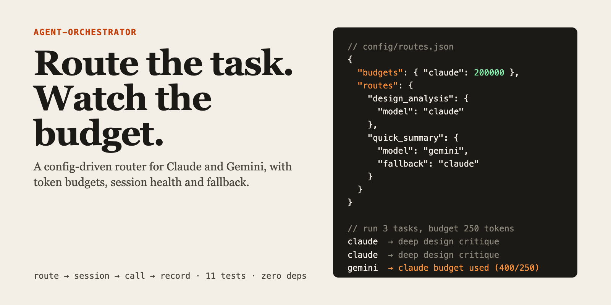

# Agent Orchestrator



A small router that sends each task to Claude or Gemini from a JSON table, tracks token use per session, and falls back to the other model when the first one fails or runs out of budget.

I run several AI agents for my own work. I wanted one place that decides which model handles what, and that tells me when a session is too long to trust, instead of finding out from a worse answer.

## How it works

```
 POST /task {taskType, prompt}
        |
        v
 router ---------> picks model from config/routes.json
   |               (budget spent? use the route's fallback)
   v
 session manager -> reuses the model's active session,
   |                opens a new one when it is full
   v
 provider --------> Claude CLI  or  Gemini API
   |                (if it fails, the fallback gets one try)
   v
 record ----------> tokens, answer hash, health, repetition
```

- **Routes are data.** `config/routes.json` maps a task type to a model, a fallback and a reason. Changing who handles `quick_summary` is a one-line edit.
- **Budgets reroute.** Once a model's tokens reach its budget, the router uses the route's fallback instead.
- **Session health.** A session is `HEALTHY`, `WARNING` (70%), `DEGRADING` (80%) or `FULL` (100% of the limit). A full session is replaced.
- **Repetition check.** Two identical answers among the last three flag the session as looping (`RESET_CONTEXT`).
- **One retry on the other model.** If the chosen provider throws, the route's fallback is tried once. If that fails too, the error goes to the caller.

## Run it

Needs Node 20+. No dependencies to install.

```bash
npm test                              # 11 tests, providers are faked
GEMINI_API_KEY=... npm start          # http://127.0.0.1:3100
curl -s localhost:3100/task -d '{"taskType":"design_analysis","prompt":"Critique this empty state"}'
```

Claude runs through the local `claude` CLI (`claude --print`), so it uses your own login. Gemini needs `GEMINI_API_KEY`; without it, Gemini routes fail and the router reports the error. Set `SYSTEM_PROMPT_FILE` to prepend a system prompt to every call.

A real run against the Claude CLI returned `pong`, with the route reason, session id and health in the response.

## Case study

**Problem.** Every agent I run called a model directly. I had no view of how many tokens a long session had burnt, and no rule for when a cheaper model was good enough.

**Constraint.** It had to run on my laptop, use the Claude login I already have, and stay readable enough to change in a minute.

| Decision | Why |
|---|---|
| Routes live in JSON, not in code | Moving a task to a cheaper model should not need a code change or a deploy. |
| Budget is a hard switch, not a score | A threshold is easy to explain and to test. A weighted score would hide why a task moved. |
| Sessions are flagged before the limit | Long contexts get worse before they fail. 70% and 80% are early warnings. |
| Providers are plain functions | Tests pass fakes. No network, no keys, no flakiness. |
| No framework, no SDK | `http` and `fetch` are enough. Nothing to update or audit. |

**Result.** 11 tests cover routing, budgets, session health, repetition, fallback and the HTTP route.

**Next.** Persist sessions across restarts, and measure answer quality per route instead of assuming it.

## Layout

| Path | What it is |
|---|---|
| `src/router.js` | Task type to model, with budget rerouting |
| `src/session-manager.js` | Tokens, health states, repetition check |
| `src/providers.js` | Claude CLI and Gemini API calls |
| `src/orchestrator.js` | Ties the pieces together, handles fallback |
| `src/server.js` | HTTP wrapper: `/task`, `/status`, `/health` |
| `config/routes.json` | The routing table |

## Status

Personal tool. Token counts are estimates (characters / 4) unless the Gemini API returns real ones. Sessions live in memory only. Prompts and comments are in English.
